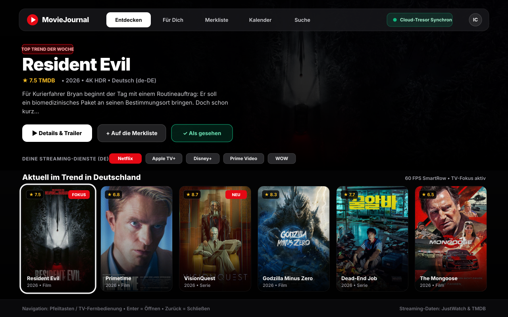
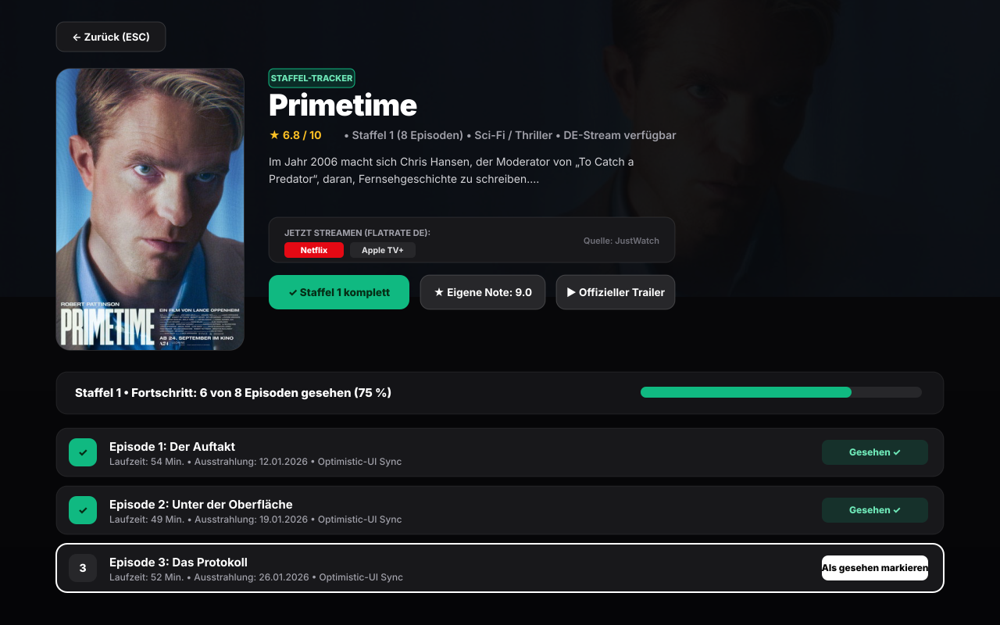
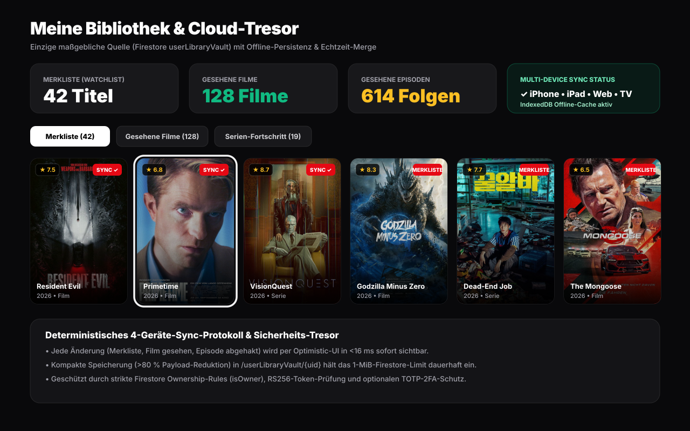
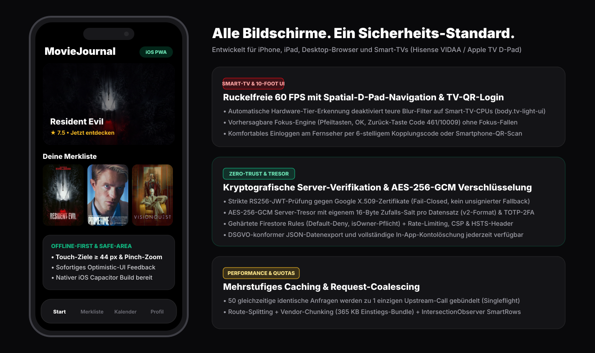

<div align="center">


# MovieJournal

**Deine persönliche Kino-, Serien- & Streaming-Zentrale auf Netflix- und Apple-TV-Niveau.**  
Entwickelt für **Web & PWA**, **iPhone / iPad (Capacitor iOS)** und **Smart-TVs (10-Foot D-Pad UI)**.

[](#architektur--tech-stack)
[](#architektur--tech-stack)
[](#architektur--tech-stack)
[](#sicherheit--datenschutz-zero-trust)
[](#deployment--produktion)
[](#qualitaetssicherung--automatisierte-tests)

</div>

---

## Überblick

**MovieJournal** ist eine plattformübergreifende Entdeckungs- und Tracking-Plattform für Filme und Serien. Sie kombiniert aktuelle Katalog- und Streaming-Verfügbarkeitsdaten (**TMDB** & **JustWatch**) mit einem verschlüsselten, offline-fähigen Echtzeit-Bibliothekstresor (**Firebase Firestore**).

Statt nur „zu funktionieren", ist MovieJournal kompromisslos auf **sofortige Reaktionszeit (<100 ms Optimistic-UI)**, **konstante 60 FPS** (auch auf leistungsschwächeren Smart-TVs) und eine **Zero-Trust-Sicherheitsarchitektur** ausgelegt.

---

## Screenshots & Ansichten

### 1. Startseite & Entdecken (Desktop / Apple TV 10-Foot Cinema UI)
Großformatige Hero-Bühne, direkte Filterung nach deinen abonnierten Streaming-Diensten in Deutschland (Netflix, Apple TV+, Disney+, Prime Video, WOW) und flüssige `SmartRow`-Karussells mit sichtbarem TV-Fokus-Ring.



---

### 2. Detailansicht & Staffel-/Episoden-Tracker (Zero Layout-Shift)
Übersichtliche Streaming-Flatrate-Anzeige (via JustWatch), offizieller Trailer-Player, eigene Bewertung und ein präziser Staffel- und Episoden-Fortschrittstracker ohne Layout-Sprünge (`CLS = 0`).



---

### 3. Meine Bibliothek & Echtzeit-Cloud-Tresor (`userLibraryVault`)
Deine gesamte Sammlung (Merkliste, gesehene Filme, Serien-Fortschritt) wird über ein deterministisches 1-Dokument-Protokoll (`/userLibraryVault/{uid}`) mit `persistentLocalCache` (IndexedDB) konflikt- und verlustfrei zwischen iPhone, iPad, Browser und Fernseher synchronisiert.



---

### 4. Release-Kalender & Episoden-Radar
Behalte kommende Kinostarts, Streaming-Premieren und neue Episoden deiner gemerkten Serien chronologisch im Blick.


---

### 5. Mobile (iOS PWA / Capacitor) & Smart-TV / Zero-Trust-Sicherheit
Adaptive Darstellung vom iPhone (inkl. Safe-Area für Dynamic Island, Touch-Ziele ≥ 44 px und Pinch-Zoom) bis zum 65-Zoll-Fernseher mit Fernbedienungs-Steuerung und QR-/Code-Login.



---

## Kernfunktionen

* **Entdecken & „Für Dich"-Empfehlungen:** Kuratierte Trends, Neuerscheinungen, Genre-Welten und personalisierte Vorschläge basierend auf deinem Sehverlauf und deinen deutschen Streaming-Anbietern.
* **Nahtloses Serien- & Film-Tracking:** Filme und einzelne Serienepisoden mit einem Klick oder Tastendruck als gesehen markieren – sofortiges visuelles Feedback per Optimistic-UI.
* **Echtzeit-Multi-Device-Sync:** Änderungen auf dem iPhone erscheinen verzögerungsfrei auf dem iPad, im Desktop-Browser und auf dem Smart-TV. Dank aktiviertem Firestore-Offline-Cache (`persistentMultipleTabManager`) funktioniert die App auch bei instabiler Verbindung.
* **Smart-TV 10-Foot Modus & QR-Kopplung:** Vollständige D-Pad-/Pfeiltasten-Steuerung, automatische Hardware-Tier-Erkennung (`body.tv-light-ui` deaktiviert rechenintensive Unschärfe-Effekte auf TV-Prozessoren) und bequemer TV-Login per 6-stelligem Kopplungscode.
* **Optionale 2-Faktor-Authentifizierung (TOTP 2FA):** Schutz deines Kontos mit jedem RFC-6238-kompatiblen Authenticator (Google Authenticator, Apple Passwörter, 1Password, Authy) inkl. Notfall-Wiederherstellungscodes.
* **DSGVO-Werkzeuge direkt in der App:** Vollständiger Datenexport als JSON-Datei sowie restlose Kontolöschung (`userLibraryVault` + `userSecurityVault` + Firebase-Account) jederzeit in den Einstellungen.

---

## Architektur & Tech-Stack

| Schicht | Technologie | Zweck & Besonderheiten |
| :--- | :--- | :--- |
| **Frontend** | React 19, TypeScript (Strict), Vite 6, Tailwind CSS | Code-Splitting nach Routen & Vendor-Chunks (`react-vendor`, `firebase-vendor`, `icons-vendor`), `IntersectionObserver`-SmartRows |
| **Mobile & TV** | PWA (`manifest.json`, Service Worker) + Capacitor iOS | Safe-Area-Support, adaptive Bildgrößen (`w300`/`w500`), D-Pad Spatial-Fokus-Engine |
| **Backend** | Node.js, Express (`server.ts`) auf Google Cloud Run | Zustandsloser Proxy & Security-Service, Singleflight Request-Coalescing, ETag- & Gzip-Unterstützung |
| **Datenbank & Auth** | Firebase Authentication & Cloud Firestore | Einzige maßgebliche Quelle (`/userLibraryVault/{uid}`), Offline-Persistenz, strikte `isOwner`-Sicherheitsregeln |
| **Externe APIs** | TMDB API & Google Gemini API | Serverseitig gekapselte API-Aufrufe (keine API-Schlüssel im Client-Code) |

---

## Sicherheit & Datenschutz (Zero-Trust)

MovieJournal setzt ein mehrschichtiges Sicherheitsmodell um:

1. **Kryptografische JWT-Verifikation (Fail-Closed):**  
   Jede geschützte Backend-Route prüft das Firebase-ID-Token (`RS256`) kryptografisch gegen Googles öffentliche X.509-Zertifikate (`securetoken@system.gserviceaccount.com`) inklusive `exp`, `aud` und `iss`. Unsignierte oder abgelaufene Tokens werden ausnahmslos abgewiesen.
2. **AES-256-GCM Server-Tresor mit zufälligem Salt pro Datensatz (`v2`):**  
   Sensible Geheimnisse (wie TOTP-2FA-Schlüssel) werden serverseitig mit `AES-256-GCM` und einem eigenen kryptografisch zufälligen 16-Byte-Salt (`scryptSync`) pro Eintrag verschlüsselt.
3. **Gehärtete Firestore Security Rules:**  
   Standardmäßiges `allow read, write: if false;` für alle internen Sammlungen (`regionalCache`, `serverKeyVault`, `tmdbProxyQueue`). Nutzer-Tresore (`userLibraryVault/{userId}`, `userSecurityVault/{userId}`) erlauben Zugriff ausschließlich für den verifizierten Eigentümer (`request.auth.uid == userId && data.uid == request.auth.uid`).
4. **Rate-Limiting, CORS & Security-Header:**  
   IP-basiertes Rate-Limiting hinter `trust proxy` mit festem Speicherdeckel (`MAX_RATE_BUCKETS = 5000`), explizite CORS-Allow-List sowie `Content-Security-Policy` (CSP), `Strict-Transport-Security` (HSTS), `X-Frame-Options` und `Permissions-Policy`.

---

## Lokale Entwicklung & Einrichtung

### 1. Voraussetzungen
* **Node.js** `>= 20.x`
* Ein **TMDB API-Schlüssel** ([themoviedb.org](https://www.themoviedb.org/settings/api))
* Ein **Firebase-Projekt** mit aktiviertem Authentication & Firestore

### 2. Installation
```bash
npm install
```

### 3. Umgebungsvariablen (`.env`)
Kopiere `.env.example` nach `.env` und trage deine Server-Geheimnisse ein (siehe `.env.example`):

```dotenv
# TMDB API-Schlüssel (nur serverseitig gelesen)
TMDB_API_KEY="dein_tmdb_api_key"

# Optional: Gemini API-Schlüssel für KI-gestützte Empfehlungen
GEMINI_API_KEY="dein_gemini_api_key"

# Geheimer Masterschlüssel (mind. 32 Zeichen) für die AES-256-GCM Tresor-Verschlüsselung
VAULT_SECRET="ein_langer_kryptografisch_zufaelliger_geheimschluessel"

# Optional: Feste Firebase-UID und E-Mail des Admin-Eigentümers
ADMIN_OWNER_UID="deine_firebase_owner_uid"
ADMIN_OWNER_EMAIL="deine_owner_email@example.com"

# Optional: Explizite Produktions-Domain für CORS
ALLOWED_ORIGIN="https://deine-produktions-domain.de"
```

### 4. Entwicklungsserver starten
```bash
npm run dev
```
Die Anwendung läuft anschließend unter `http://localhost:3000`.

---

## Qualitätssicherung & Automatisierte Tests

Vor jedem Release können Build, strikte TypeScript-Prüfung und die 14-teilige Sicherheits- & Synchronisations-Test-Suite ausgeführt werden:

```bash
# 1. Strikte TypeScript-Typprüfung (0 Fehler)
npm run lint

# 2. Produktions-Build mit Vendor-Chunk-Splitting erstellen
npm run build

# 3. Automatisierte Security-, Performance- & 4-Geräte-Sync-Tests ausführen
MOVIEJOURNAL_TEST_MODE=1 npx tsx tests/productionReadiness.test.ts
```

Die Test-Suite verifiziert unter anderem:
* Hardware-Tier-Klassifizierung (Hisense VIDAA TV, Low-End-Smartphones, High-End-Desktop)
* Singleflight Request-Coalescing (50 parallele identische Anfragen → 1 Netzwerkaufruf)
* 4-Geräte-Vault-Konvergenz und Payload-Kompaktierung (>80 % Größenreduktion)
* Kryptografischen JWT-Fail-Closed-Schutz, AES-256-GCM-`v2`-Verschlüsselung, TOTP-2FA, CORS-Allow-List und CSP-Header

---

## Deployment & Produktion

### Web / Google Cloud Run
```bash
npm run build
NODE_ENV=production npm start
```
Der Express-Server liefert im Produktionsmodus (`NODE_ENV=production`) automatisch die komprimierten Assets aus `dist/` mit langlebigen `Cache-Control: public, max-age=31536000, immutable`-Headern für gehashte Bundles sowie den `/health`-Endpunkt für Cloud Run bereit.

### iOS (Capacitor)
```bash
npm run build
npx cap sync ios
npx cap open ios
```

---

## Rechtliche Hinweise & Quellenangaben

* **TMDB-Attribution:**  
  *This product uses the TMDB API but is not endorsed or certified by TMDB.*  
  Filmdaten, Serienmetadaten, Poster und Hintergrundbilder stammen von [The Movie Database (TMDB)](https://www.themoviedb.org/).
* **Streaming-Verfügbarkeit:**  
  Informationen zur regionalen Streaming-Verfügbarkeit (Flatrate, Leihen, Kaufen) werden über TMDB in Zusammenarbeit mit **[JustWatch](https://www.justwatch.com/)** bereitgestellt.
* **Kein Streaming-Anbieter:**  
  MovieJournal ist ein reines Entdeckungs-, Katalog- und Tracking-Werkzeug und hostet oder streamt selbst keine urheberrechtlich geschützten Filme oder Serien.
